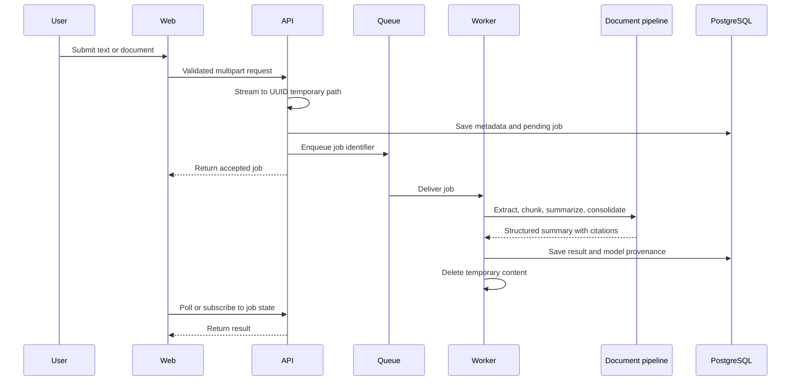

# Summarization data flow

This document describes the target flow implemented incrementally in Phases 6
through 9.

The API rejects unsupported media and oversized input before queueing. The worker
cleans up on success, failure, timeout, and cancellation. A startup sweeper will
remove abandoned temporary content after a bounded TTL. Raw document content is
excluded from logs, metrics, audit events, and database backups.
