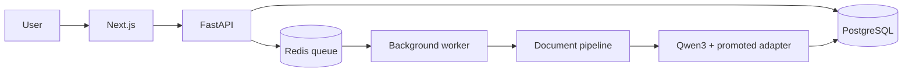
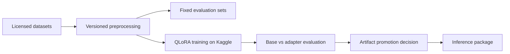

# System overview

## Design principle

The project separates the ML lifecycle from the request-serving lifecycle. Data
preparation and model training produce versioned artifacts; the application
consumes only an explicitly promoted model or adapter.

## Target flow

## Offline ML flow

## Boundaries

- `apps/web` owns browser presentation and user interaction.
- `services/api` owns HTTP validation and application orchestration.
- `services/worker` will own asynchronous job execution, not training.
- `ml` owns preprocessing, evaluation, training, and inference logic.
- `packages/contracts` will hold generated client contracts rather than manually
  duplicated request types.
- infrastructure configuration must not contain application secrets.

Phase 1 implements only the web/API shells and the importable ML boundary.
